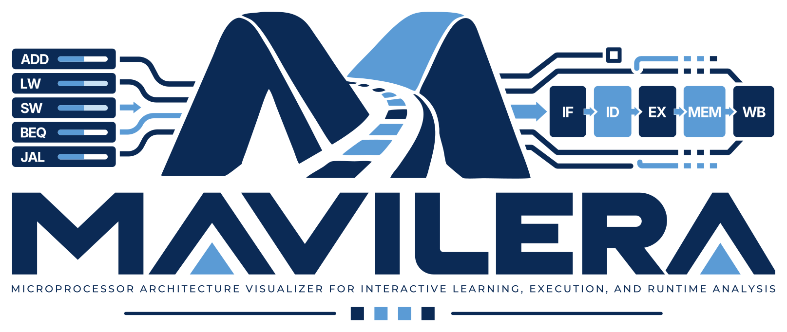
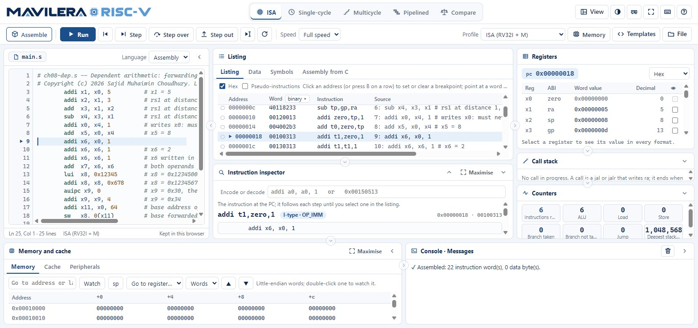
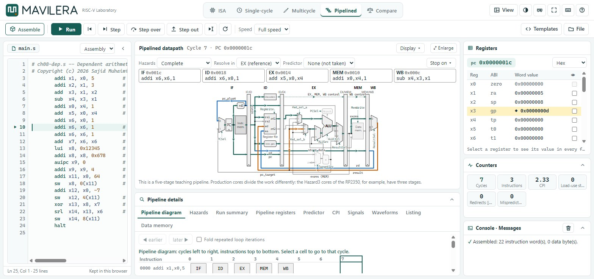
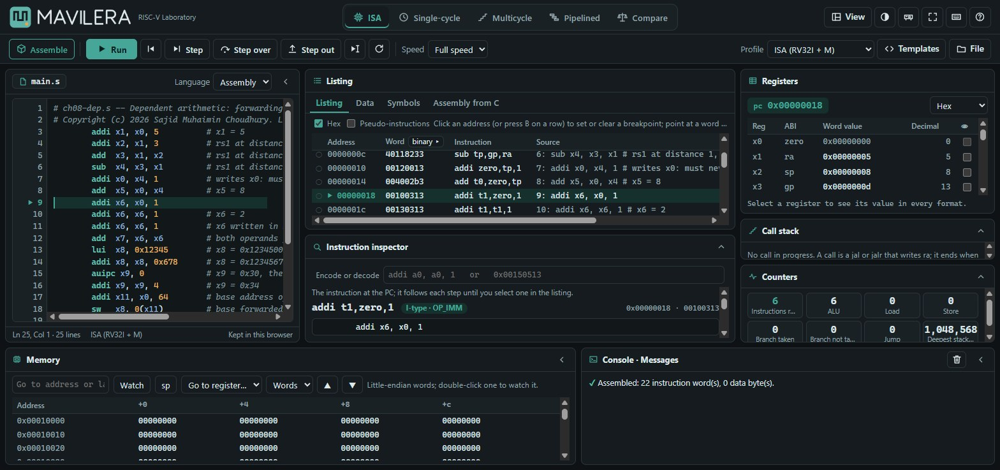

# MAVILERA



**Interactive Microprocessor Architecture Laboratory** — *Visualize. Execute. Understand.*

MAVILERA (**M**icroprocessor **A**rchitecture **V**isualization, **I**nteractive
**L**earning, **E**xecution, and **R**untime **A**nalysis) is an open-source,
architecture-neutral educational platform for interactive exploration of
computer and microprocessor architecture. Every simulator runs entirely in the
browser; no program or data is uploaded.

MAVILERA is a provisional project name, pending legal clearance, and is not a
registered trademark (see [`TRADEMARKS.md`](TRADEMARKS.md)).

| Module | Status | Address |
|---|---|---|
| **RISC-V Laboratory** | available | `https://sajidlab.org/mavilera/riscv/` |
| **SAP-1 Laboratory** | available | `https://sajidlab.org/mavilera/sap-1/` |
| **SAP-2 Laboratory** | available | `https://sajidlab.org/mavilera/sap-2/` |
| **Armv7 Laboratory** | available (from 1.1.0) | `https://sajidlab.org/mavilera/armv7/` |
| **NPU** (a tool of the RISC-V Laboratory) | available (from 1.2.0) | `https://sajidlab.org/mavilera/riscv/?tool=npu` |
| **GPU Laboratory** | available (from 1.3.0; a preview in 1.2.0) | `https://sajidlab.org/mavilera/gpu/` |
| Intel 8086 | beta, not published | — |
| MOS 6502, MIPS | planned, not built | — |

The landing page is `https://sajidlab.org/mavilera/`. Each simulator is
independent: its own execution engine, tests, build and address. See
[`docs/ADDING-SIMULATORS.md`](docs/ADDING-SIMULATORS.md) and
[`docs/DEPLOYMENT.md`](docs/DEPLOYMENT.md).

MAVILERA is independent of RISC-V International, Arm, Intel and any other owner
of an architecture name, and is not endorsed by them. It needs no textbook,
course or account; the RISC-V processors and their drawings follow the author's
book *Microprocessor Architecture and Embedded Systems*.

# The RISC-V Laboratory
## Features

- **Assembler and disassembler** for RV32I + M: pseudo-instructions,
  several source files, diagnostics with fix hints, a listing with the
  machine word in hexadecimal and in binary grouped by field.
- **Instruction-level simulator** with step, step back, step over, step out,
  run to cursor, breakpoints, watchpoints, a run budget, a calling-convention
  check and per-class counters; `write` and `exit` system calls.
- **C compiler** for a teaching subset of C, in a plain (variables in memory)
  and a register translation, for RV32I or RV32IM; each C line linked to its
  assembly.
- **Processor views:** a single-cycle, a multicycle and a five-stage
  pipelined RV32I processor, each animated at signal level on its datapath
  drawing, with control tables, the multicycle controller's state diagram,
  pipeline registers, hazard handling (forwarding, stalls, flushes, from none
  to complete), branch predictors, the pipeline diagram and the CPI.
- **Comparison** of one program on the three processors: instructions,
  cycles, CPI, clock period, execution time and speed-up, with illustrative
  delays.
- **Templates:** 21 short teaching programs, grouped by view, from a toolbar
  menu; each opens in its view with its settings and says what to try.
- **Waveforms** of chosen signals in each processor view, over the cycles run
  so far; an **uninitialised-value check** (registers and stack words read
  before anything wrote them); an **exercise mode** with 14 practice exercises
  written for the tool (and a teacher's own exercise files) that runs the
  tests on your program and shows expected against actual.
- **Your work is kept** in the browser across a refresh or a closed tab:
  program, file name, cursor, breakpoints, watchpoints, data loads and the
  step reached.
- **Exports:** `$readmemh` and binary images, listings, golden dumps for
  RTL testbenches, traces (JSON lines, CSV) and VCD waveforms of the
  processor signals; diagrams as SVG and PNG. A headless runner
  (`tools/risc-vista-run.mjs`) runs the same code under Node.js.

## Interface



The page is a workspace of panes, in the manner of a code editor:

- **Header.** The MAVILERA logo (the symbol alone below 700 px); the views
  *ISA*, *Single-cycle*, *Multicycle*, *Pipelined* and *Compare*; the *View*
  menu, the theme (system, dark, light), projector mode, full screen, the
  keyboard shortcuts and *Help* (topics, a link to the full documentation,
  and *About*).
- **Toolbar.** *Assemble* (*Compile* for C), *Run* / *Pause*, *Step back*,
  *Step*, *Step over*, *Step out*, *Run to cursor*, *Reset*, the speed, the
  profile and the *File* menu (open, save, exports). Each control has a
  tooltip with its name and shortcut. When the window is narrow, some
  controls show only their icon; on touch screens every label is shown.
- **Editor.** The file as a tab, the language (assembly or C), line numbers
  and a breakpoint gutter (click a line number), error marks, and a status
  line: cursor, profile, and whether the text is newer than the program.
- **Listing** with breakpoints and the current instruction; **Instruction
  inspector** with the word split into its fields (shaded by role and
  named), the decoded fields and the operation; **Registers** with the PC,
  the value in the chosen format and in decimal, the last change marked ◆,
  and every format of a selected register; **Counters** as cards (cycles and
  CPI in the processor views, hazard counts in the pipelined view);
  **Memory** with address search, *sp* and *Go to register…* to jump to
  where a register points, and watches; **Console** with a *Clear* button.

| Key | Action |
|---|---|
| Ctrl+Enter | Assemble or compile |
| F5 | Run / pause |
| F10, Shift+F10 | Step, step back |
| F11, Shift+F11 | Step over, step out |
| Ctrl+F10 | Run to cursor |

### Resizable panes

Every boundary between panes is a divider: editor | listing | registers,
listing over inspector, registers over counters, the workspace over the
memory and console dock, and memory | console. Drag a divider with the mouse,
a finger or a pen; or focus it with Tab and use the arrow keys (Shift for
larger steps). A double click or Enter returns it to its default. Each pane
has a minimum size. The inspector, counters, editor, memory, console and the
whole dock fold with the chevron in their heading (or from *View*); a folded
pane keeps its heading, and its share returns when it opens.

Sizes are kept in this browser, for each view separately (the processor
views lay out a drawing and its details instead of the listing and
inspector). *View ▸ Reset layout* forgets them. The saved layouts carry a
version, so a later change of the panes discards them rather than
misapplying them. Below 900 px the panes stack and the page scrolls.



### Themes

Light, dark, or following the system (the button in the header cycles
through them; the choice is kept in the browser). Both themes share every
rule; only the colour tokens in `src/ui/theme.css` change.




## Development

Requires Node.js 20 or later for the development server, the tools and the
tests only; the site has no runtime dependencies.

```powershell
npm run dev                  # the RISC-V Laboratory at http://127.0.0.1:8000/
npm test
npm run smoke                # interface smoke tests in the installed Chrome and Edge
node tools/make-mavilera-brand.mjs   # the logo files and icons (content/branding/mavilera/)
```

### Release build

```powershell
# the validation record web-sim-validation.json is made by the maintainer's private verification (it needs the author's
# private reference material); a release is built only from a passing record that matches the files
npm run release                 # dist/: refuses unless the record passes and matches the files
npm run preview                 # the same build without the gates, served on http://127.0.0.1:8001/
```

`dist/` is the whole site: the MAVILERA landing page at its root (built from
`site/index.html` and the registry `site/architectures.json`), the RISC-V
Laboratory in `riscv/` (shell, documentation, service worker, single-file
offline build, files under a folder named by their hash). Every path in it is
relative, so it works under `/mavilera/` or any other base. `BASE_PATH`
(default `/mavilera/`) only sets the address printed on the landing page.

## Licence

Copyright (c) 2026 Sajid Muhaimin Choudhury. The repository is licensed under
the Apache License, Version 2.0 ([`LICENSE`](LICENSE), [`NOTICE`](NOTICE)),
code and `content/` alike. The names and the logo are not licensed as
trademarks ([`TRADEMARKS.md`](TRADEMARKS.md)). Third-party components:
[`THIRD_PARTY.md`](THIRD_PARTY.md).